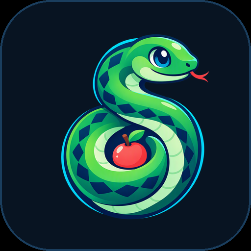
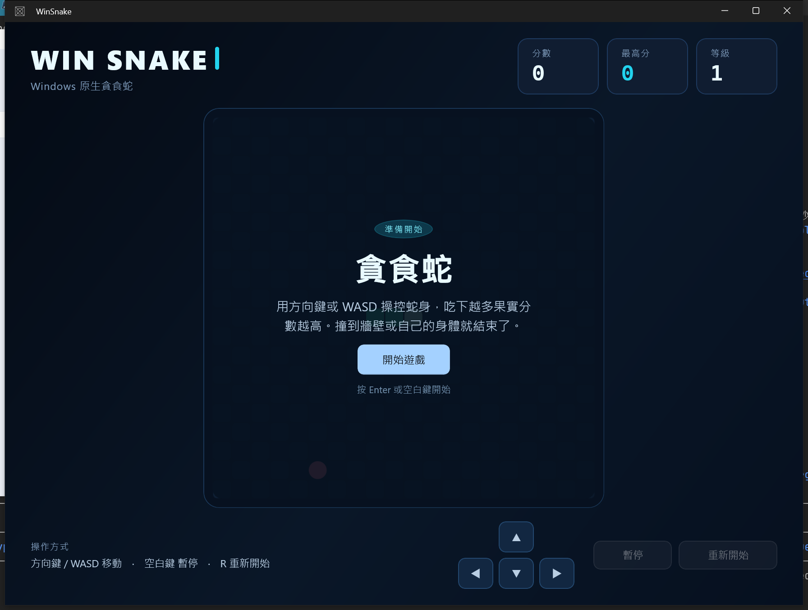

<p align="center">
  
</p>

# WinSnake（貪食蛇）

以 **WinUI 3 / Windows App SDK** 打造的 Windows 原生貪食蛇遊戲。提供免安裝的單一檔案可攜版，下載後直接執行即可遊玩。



## 下載

前往 [Releases](https://github.com/doggy8088/WinSnake/releases/latest) 下載：

| 檔案 | 大小 | 說明 |
| --- | ---: | --- |
| `WinSnake.exe` | 約 36.6 MB | Windows x64 可攜單檔版（免安裝） |

**系統需求：** Windows 10 1809（`10.0.17763`）以上、x64。不需要另外安裝 .NET 或 Windows App SDK。

> 可攜版首次啟動時，會將執行所需的內容解壓縮到使用者暫存資料夾，可能需要幾秒鐘。
>
> 請保持檔名為 `WinSnake.exe`。WinUI 3 會依執行檔名稱載入資源，重新命名可能導致無法啟動。

## 遊戲方式

| 操作 | 按鍵 |
| --- | --- |
| 移動 | 方向鍵 / `W` `A` `S` `D` |
| 暫停 / 繼續 | `Space` / `P` / `Esc` |
| 開始 / 再玩一次 | `Enter` / `Space` |
| 重新開始 | `R` |

也可以使用畫面上的方向按鈕、暫停與重新開始按鈕。視窗失去焦點時會自動暫停。

## 功能

- 20×20 棋盤，吃到果實會成長並加分，每吃 5 顆果實提升等級
- 速度隨分數加快；撞到牆壁或自己的身體即結束
- 最高分自動保存（封裝版使用套件設定，可攜版使用 `%LOCALAPPDATA%\WinSnake\highscore.json`）
- 專屬品牌標誌、霓虹背景與蛇角色點綴
- 可攜版採部分 trimming 與精簡的 Windows App SDK 元件，單檔約 36.6 MB
- 深色霓虹介面、等比縮放棋盤、視窗最小尺寸限制
- 鍵盤與螢幕按鈕皆可操作，文字尺寸針對高 DPI 螢幕調整
- 遊戲規則為獨立類別庫，附 14 個單元測試

## 開發

### 需求

- Windows 10 1809 以上
- [.NET 10 SDK](https://dotnet.microsoft.com/)
- [winapp CLI](https://github.com/microsoft/WinAppCli) 0.7 以上

### 建置與執行

```powershell
git clone https://github.com/doggy8088/WinSnake.git
cd WinSnake
winapp run .
```

`winapp run` 會建置專案、註冊偵錯身分並啟動應用程式。

若註冊失敗（例如出現 `0x8007007B`），可改用手動註冊：

```powershell
dotnet build WinSnake.csproj -c Debug
powershell -Command "Add-AppxPackage -Register .\bin\Debug\net10.0-windows10.0.26100.0\win-x64\AppxManifest.xml"
explorer.exe "shell:AppsFolder\WinSnake_nq8q93nykd4et!App"
```

實際的 Package Family Name 可用 `Get-AppxPackage -Name WinSnake` 查詢。

### 測試

```powershell
dotnet test Tests\WinSnake.Core.Tests\WinSnake.Core.Tests.csproj
```

### 建置可攜單檔版

```powershell
dotnet publish WinSnake.csproj -p:PublishProfile=Portable-win-x64
```

輸出為 `publish\portable\win-x64\WinSnake.exe`，單一檔案已包含 .NET 執行階段與 Windows App SDK。發行設定使用部分 trimming，並只引用 WinUI、DWrite 與 Runtime 元件，避免把未使用的 AI/ML/Search/Widgets 載入可攜版。

## 專案結構

```text
WinSnake/
├─ Core/                      # 遊戲引擎（與 UI 無關）
├─ Tests/WinSnake.Core.Tests  # xUnit 單元測試
├─ Assets/Branding/           # 標誌、蛇角色與霓虹背景
├─ docs/logo.png              # README 品牌標誌
├─ docs/screenshot.png        # 遊戲截圖
├─ MainPage.xaml(.cs)         # 遊戲畫面、渲染與輸入
├─ MainWindow.xaml(.cs)       # 視窗尺寸、DPI 縮放與焦點暫停
├─ HighScoreStore.cs          # 最高分保存（封裝／可攜兩用）
├─ Package.appxmanifest       # MSIX 身分與視覺資產
└─ Properties/PublishProfiles/Portable-win-x64.pubxml
```

## 授權

[MIT](LICENSE)

